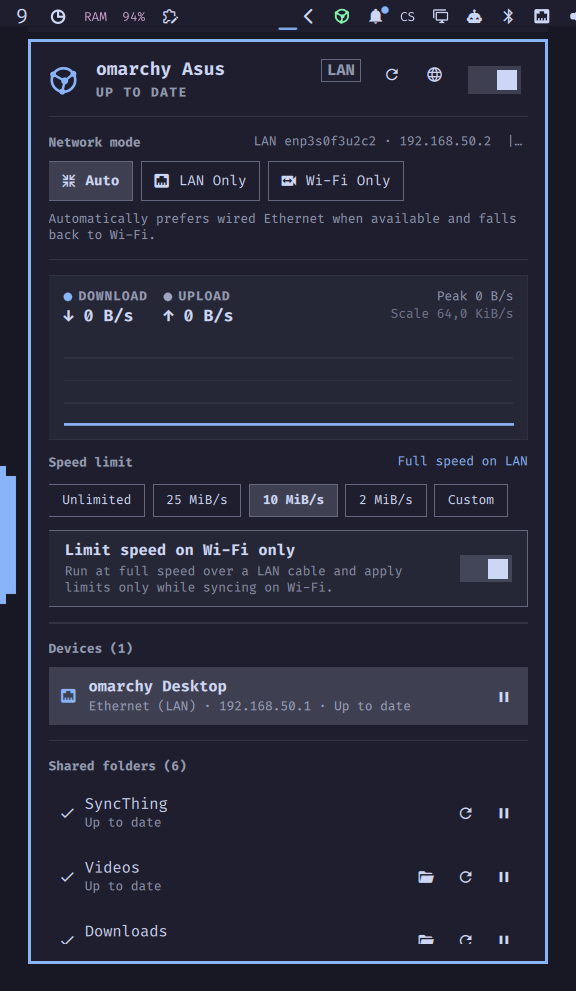

# Omarchy Syncthing (`gruut.syncthing`)

[](https://omarchy.org/)
[](LICENSE)

Theme-aware **Syncthing** control panel and bar widget for [Omarchy](https://omarchy.org/) (`omarchy-shell` / Quickshell). Switch synchronization between **Auto**, **LAN Only**, and **Wi-Fi Only**, establish direct PC-to-Notebook Link-Local cable transfers in one click, monitor real-time throughput on a dual-curve vector graph, apply smart Wi-Fi-only speed limits, and manage devices and shared folders right from the bar.

<p align="center">
  
</p>

## Highlights

- **Network Transport Selector (`Auto` · `LAN Only` · `Wi-Fi Only`)**
  - **Auto (Prefer LAN):** Uses both wired Ethernet and Wi-Fi, automatically probing and upgrading peer sessions onto a fast LAN cable as soon as a wired link comes up — without restarting `syncthing.service` — and restoring full Wi-Fi fallback when unplugged.
  - **LAN Only:** Pins Syncthing's `listenAddresses`, `allowedNetworks`, and static peer addresses strictly to active wired Ethernet subnets. Automatically pauses synchronization whenever the LAN cable is unplugged so zero traffic leaks over Wi-Fi.
  - **Wi-Fi Only:** Pins synchronization strictly to active wireless interfaces and auto-pauses when Wi-Fi disconnects.
  - **Non-destructive baseline backup:** Switching back to `Auto` restores your original Syncthing `listenAddresses`, `allowedNetworks`, and device `addresses`.
- **Direct PC-to-Notebook Cable Helper (Link-Local)**
  - Detects when a physical Ethernet cable is connected between two machines without a router/DHCP server (`carrier = 1`, no IP assigned) and offers one-click activation of a dedicated `ipv4.method link-local` NetworkManager profile (`omarchy-syncthing-lan`, `autoconnect = no`), with a one-click **Restore DHCP** button when plugging back into a router.
- **Live Dual-Curve Transfer Graph**
  - Smooth 60-sample vector chart (`QtQuick.Shapes` + `CurveRenderer`) displaying live download (`↓` accented gradient fill) and upload (`↑` secondary stroke) rates with automatic vertical scale ranging and peak speed readout.
  - Adaptive polling (`1s` while the panel is open or actively syncing, `5s` when idle in the background).
- **Bandwidth Limiter & Smart Wi-Fi-Only Cap**
  - Quick presets (`Unlimited`, `25 MiB/s`, `10 MiB/s`, `2 MiB/s`, `Custom`), independent 16-stop notched Download/Upload sliders (`128 KiB/s` – `100 MiB/s`), and **Limit speed on Wi-Fi only** so wired LAN cable transfers always run uncapped (`Full speed on LAN`).
- **Interactive Devices & Shared Folders**
  - Inspect per-device transport (`Ethernet (LAN)` vs `Wi-Fi`), peer IP address, and sync completion `%`.
  - Pause/resume individual devices or folders, trigger folder rescans, view live sync progress bars, and open shared directories directly in your file manager.
- **Native Omarchy Look & Keyboard-First Navigation**
  - Built exclusively with Omarchy's `qs.Ui` primitives (`PanelHero`, `ButtonGroup`, `PanelSlider`, `Toggle`, `ToggleSwitch`, `CursorSurface`, `PanelActionButton`, `PointerMoveGate`), following active theme colors and Hyprland corner rounding live.

## Install

Requires Omarchy 4.0+ and a local `syncthing` instance listening on loopback (`127.0.0.1:8384` or `[::1]:8384`).

```bash
omarchy plugin add https://github.com/Morganczech/omarchy-syncthing --enable
```

If the widget does not appear immediately, restart the shell once:

```bash
omarchy restart shell
```

For a brand-new machine with no Syncthing configuration yet, an optional helper script is included to generate local-only defaults (global discovery, relays, and NAT disabled; local discovery and staggered file versioning enabled):

```bash
./setup-local.sh
```

## Controls & Keyboard Shortcuts

| Input | Action |
| --- | --- |
| **Left-click** bar icon | Open / close the Syncthing panel |
| **Right-click** bar icon | Pause / resume all synchronization |
| **Middle-click** bar icon | Rescan all shared folders |
| `j` / `k` or `Down` / `Up` | Move cursor across sections, devices, and folders |
| `h` / `l` or `Left` / `Right` | Switch `ButtonGroup` options, adjust custom speed sliders, or pick folder actions |
| `Enter` / `Space` | Activate focused control |
| `1` / `2` / `3` | Switch network mode (`Auto` / `LAN Only` / `Wi-Fi Only`) |
| `p` | Pause / resume all synchronization |
| `r` | Rescan all shared folders |
| `o` | Open local Syncthing Web Interface |
| `Esc` | Close panel |

## Shell IPC Automation

Control the widget from scripts or Hyprland keybindings via `omarchy-shell`:

```bash
omarchy-shell gruut.syncthing toggle
omarchy-shell gruut.syncthing status
omarchy-shell gruut.syncthing setTransport ethernet   # auto | ethernet | wifi
omarchy-shell gruut.syncthing pause
omarchy-shell gruut.syncthing resume
omarchy-shell gruut.syncthing rescan
```

## Security Model

Omarchy shell plugins run inside the user's `omarchy-shell` session, so `gruut.syncthing` enforces strict defense-in-depth boundaries:

- **API Key Isolation:** Syncthing's `apikey` is read strictly inside `syncthing.py` from local `config.xml` (`O_NOFOLLOW`, capped at `2 MiB`, rejecting XML `DOCTYPE`/`ENTITY` declarations against XXE, and requiring a loopback GUI address `127.0.0.1` or `[::1]`). The API key is never exposed to `stdout`, `stderr`, CLI arguments, environment variables, or QML state.
- **Zero Shell Execution:** All subprocess invocations use fixed absolute binary paths (`/usr/bin/python3 -I -B`, `/usr/bin/ip`, `/usr/bin/nmcli`, `/usr/bin/xdg-open`) with explicit argument arrays (`shell=False`). Isolated no-bytecode Python (`-I -B`) prevents `PYTHONPATH` injection and `__pycache__` hot-reload loops.
- **Strict Input Allowlisting:** Device IDs, folder IDs, physical interface names (`/sys/class/net` verified), transport modes, and bandwidth bounds (`0`–`10 GiB/s`) are validated before calling REST endpoints or NetworkManager.
- **QML PlainText & Markup Neutralization:** Every QML `Text` element explicitly sets `textFormat: Text.PlainText`, and dynamic strings passed into shared `qs.Ui` controls are length-bounded and sanitized against markup/control-character injection.
- **Symlink-Safe Atomic State:** Policy state in `$XDG_STATE_HOME/omarchy-syncthing/state.json` is stored in a `0700` directory using `O_NOFOLLOW` reads and `0600` atomic `mkstemp` + `os.replace` writes.

## Validation & Tests

```bash
python3 -I -B -m unittest discover -s tests -v
omarchy plugin validate .
```

## Update & Uninstall

```bash
# Update to the latest release
omarchy plugin update gruut.syncthing

# Move widget to another bar section
omarchy bar move gruut.syncthing --section right

# Remove plugin
omarchy plugin remove gruut.syncthing
```

## License

[MIT](LICENSE) © 2026 [Morganczech](https://github.com/Morganczech)
